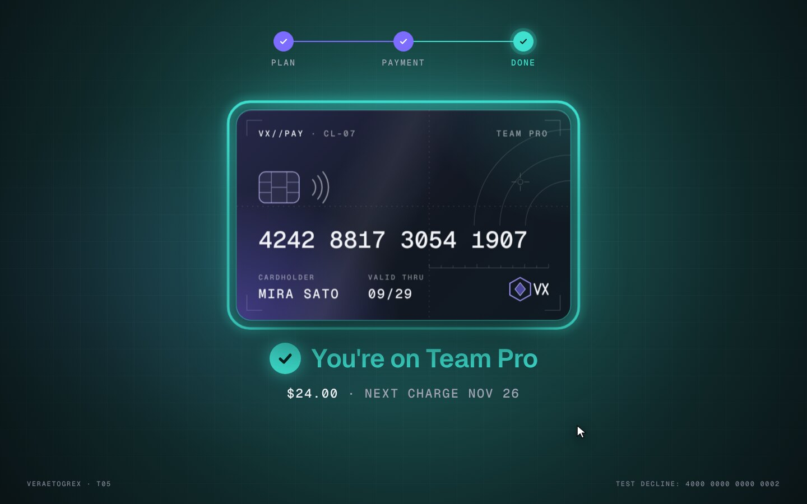

# Upgrade Checkout

**The card turns around when you need the CVV.**



**Live demo:** [veraetogrex-portfolio.github.io/upgrade-checkout](https://veraetogrex-portfolio.github.io/upgrade-checkout/) · **Mockup:** [full-screen version](https://veraetogrex-portfolio.github.io/upgrade-checkout/mockup/upgrade-checkout.html)

The card mirrors what you type and turns around when the CVV field gets focus. On pay it glides to the centre while a stroke runs around it: Ion if paid, Flare if declined.

## Use it

Three files, no build step, no dependencies, no web fonts:

```
index.html   markup
style.css    styles and keyframes
script.js    behaviour
```

Download the repo and open `index.html`, or copy the three files into your project.

## Try it

- Any valid-looking card goes through.
- `4000 0000 0000 0002` is always declined, to see the error path.

## Make it yours

`charge()` in `script.js` is a stub. Replace it with a request to your payment provider. Colours are CSS custom properties at the top of `style.css`.

`prefers-reduced-motion` is respected: heavy motion drops to short fades.

## What's in `mockup/`

The full 1440×900 screen this component was shot in for the reel:

- `mockup/upgrade-checkout.html` — interactive. `D` plays the demo, `R` resets.
- `mockup/upgrade-checkout.autoplay.html` — the scripted ~6 s loop with a drawn cursor.
- URL flags: `?frame` puts the screen in a browser window, `?clean` hides the control panel, `?once` plays the demo once.

The mockup uses a shared stage runtime and bundled fonts from `mockup/_shared/`. The component in the root doesn't need any of it.

---

Component 05 of a series. New one every day on Instagram [@veraetogrex_portfolio](https://www.instagram.com/veraetogrex_portfolio/) · all components: [github.com/veraetogrex-portfolio](https://github.com/veraetogrex-portfolio)

MIT licensed.
